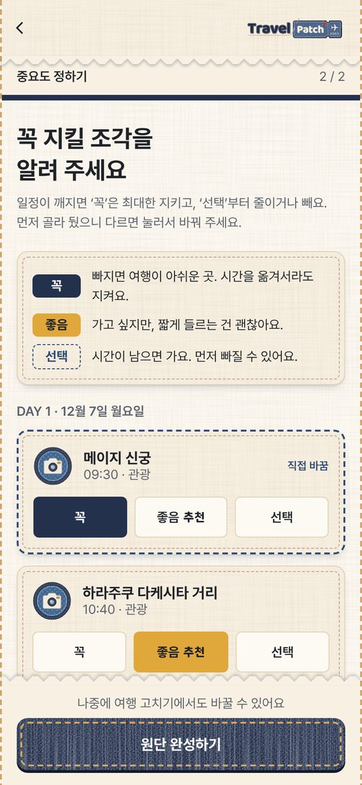
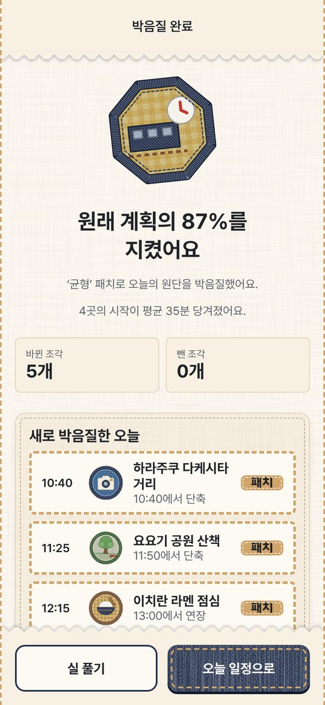
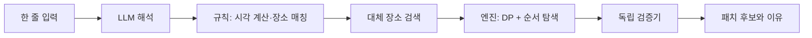

# TravelPatch

여행 중에 일정이 틀어졌을 때, 일정을 새로 짜지 않고 원래 일정에서 꼭 바꿔야 하는 부분만 고쳐 주는 웹서비스.

데모: https://travel-patch.vercel.app · 실전웹서비스개발(2026-2) 개인 프로젝트 · 2026.10 – 2026.11

## 화면

| 시작 | 일정 붙여넣기 | 재단 확인 | 중요도 3탭 |
|:---:|:---:|:---:|:---:|
|  |  |  |  |
| 새로 짜지 않고 덧대어 고친다 | 메모·카톡 그대로 | 장소 매칭·숙소 복귀 시각 | `꼭` · `좋음` · `선택` |

| 한 줄 → 칩 | 패치 후보 | 대체·대기·이유 | 박음질(확정) |
|:---:|:---:|:---:|:---:|
|  |  |  |  |
| 사건 3개가 칩으로, 고치기·빼기 | 후보 3개, 보존율 한 줄 | 요요기 공원 → 미술관(비), 라멘 +40분 | 원래 계획의 87% 유지 |

<sub>도쿄 당일 일정에 "12시부터 비가 온대. 스카이 예약은 1시간 앞당겨졌고 라멘집은 대기 40분이래"를 입력한 흐름 (Google·OpenAI 응답은 테스트용)</sub>

## 기획 의도

여행 중에 늦잠을 자거나 비가 오거나 식당이 문을 닫으면 일정이 줄줄이 꼬인다. AI 플래너는 일정을 처음부터 다시 짜 주지만, 예약과 동선을 다 짜 둔 여행자에게 필요한 건 "원래 계획에서 뭘, 얼마나, 왜 바꿔야 하는지"다.

LLM에게 일정을 고쳐 달라고 해 보니 답의 83%가 영업시간이나 예약 시각 같은 조건을 어겼다. 그래서 일정 복구를 "원래 일정을 최소한으로 바꾸는 최적화 문제"로 보고 솔버를 직접 만들었다. LLM은 사용자의 말을 데이터로 옮기는 데만 쓴다.

## 주요 기능

- 일정 붙여넣기: 메모나 카톡에 적은 일정을 붙여 넣으면 시각과 장소로 정리하고 실제 장소를 찾아 준다.
- 한 줄 입력: "비 오고 예약 1시간 당겨졌어"처럼 여러 상황을 한 문장으로 말하면 칩으로 확인하고 고칠 수 있다.
- 패치 후보: 원래 계획을 몇 % 지켰는지와 바뀐 곳, 바뀐 이유를 후보 2–3개로 보여 준다.
- 대체 장소: 휴무나 비 때문에 못 가는 곳은 근처의 비슷한 장소(비가 오면 실내)로 바꿔 준다.
- 되돌리기: 마음에 안 드는 변경은 원래대로 고정하고 다시 계산하고, 확정한 패치도 되돌릴 수 있다.

## 시스템 구조



- 엔진은 LLM, DB, 네트워크를 쓰지 않는 순수 함수라서 같은 입력이면 항상 같은 결과가 나온다.
- 솔버 결과는 솔버와 따로 만든 검증기를 통과해야만 사용자에게 간다.
- 숫자는 LLM이 만들지 않는다. "1시간 앞당겨졌어"에서 LLM은 `-60`만 뽑고, 새 시각은 규칙이 계산한다.

최적화는 남은 일정마다 유지·이동·단축·삭제·대체·연장 중 하나를 고르고, 삭제·단축한 일정의 가치와 순서·시각·이동시간 변화를 합친 비용이 가장 작은 안을 찾는다. 가중치가 다른 전략(관광 보존, 여유, 이동 최소화 등)마다 풀어서 서로 다른 후보를 낸다.

## 성능 평가

| 50개 시나리오 | 제약 위반 | 원래 일정 보존율 |
|---|---|---|
| 전부 뒤로 밀기 | 62% | 93.8% |
| LLM 단독 | 83% | 78.2% |
| LLM + 검증기 | 0% (42개는 답 못 냄) | 82.9% |
| TravelPatch 엔진 | 0% | 90.2% |

- 사건 2–3개가 겹친 30개 시나리오에서도 위반 0%, 보존율 90.5%였다.
- 한 줄 입력 해석은 문장 52개 중 50개, 사건이 겹친 문장 12개 중 12개를 맞혔다(처음엔 52개 중 43개).

자세한 결과: [`eval/results/summary.md`](eval/results/summary.md)

## 트러블슈팅

- 실제 등록한 여행에서는 비가 와도 일정이 안 바뀌었다. 장소의 야외/실내 정보가 비어 있었다. Google 장소 종류(park, museum 등)로 채우게 했다.
- 루브르 휴관 시 같은 날 이미 가는 카페나 숙소가 대체 장소로 뽑혔다. 그날 일정·숙소 근처와 종류가 다른 곳을 후보에서 뺐다.
- 모델이 사용자가 하지 않은 바람(실내, 쉬기)을 지어냈다. 바람마다 근거 단어를 받아 원문에 없으면 버리게 했다.
- 테스트 몇 번 만에 Google 일일 한도에 걸렸다. 후보마다 하던 영업시간 조회를 검색 한 번에 합쳐 비용을 4분의 1로 줄였다.

## 기술 스택

FastAPI · Pydantic v2 · Python 3.12 · React 19 · TypeScript · Vite · Supabase · OpenAI · Google Places · Vercel · Render

테스트: 백엔드 754개, 프론트 143개, 실제 API 호출 테스트 96개

## 실행 방법

```bash
# 루트에 .env: OPENAI_KEY, GOOGLE_PLACES_API_KEY, SUPABASE_URL, SUPABASE_ANON_KEY, SUPABASE_SERVICE_ROLE_KEY
cd backend && uv sync && uv run uvicorn app.main:app --reload
cd frontend && npm install && npm run dev
```

## 한계 및 향후 계획

- 이동시간 정확도: 지금은 직선거리에 수단별 보정값을 곱해 추정한다. Google Routes API 연동은 만들어 두었지만 비용 때문에 꺼 두었다. 결제를 붙여 켜면 실제 경로 기준으로 동선과 이동시간을 더 정확하게 반영할 수 있다.
- 사용자 맞춤: 지금은 일정마다 꼭/좋음/선택 등급만 반영한다. 여유롭게 다니는지 빡빡하게 다니는지 같은 성향과, 음식·쇼핑·관광 중 무엇을 좋아하는지를 받아서 일정을 고칠 때 무엇을 먼저 지킬지 정하는 데 반영하고 싶다.
- 등록 시 검사: 처음부터 불가능한 일정(이동시간 없이 이어지는 예약)을 등록할 때 알려 주지 않는다.
- 범위: 한 여행은 한 도시, 복구는 하루 단위다.
