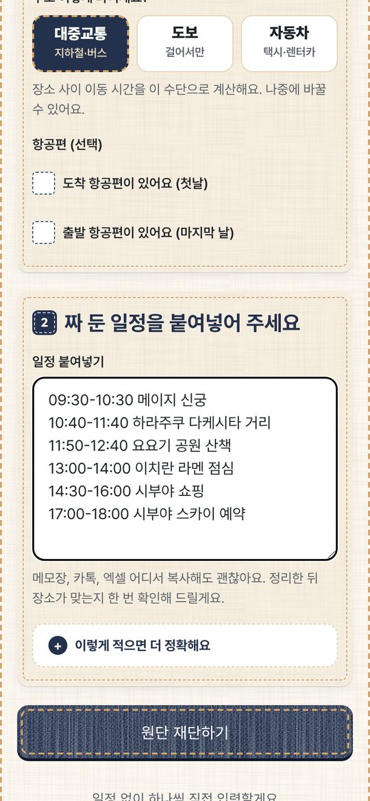
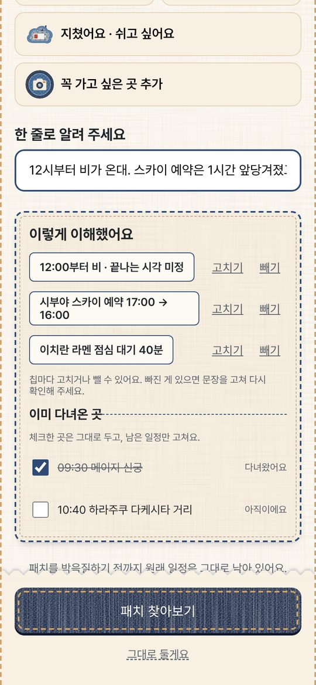
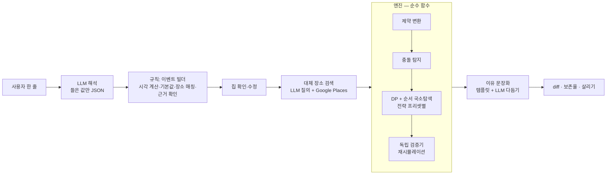

# TravelPatch

> 여행 중 깨진 일정을 **새로 짜지 않고**, 원래 일정에 대한 **최소한의 수정(patch)** 과 그 근거를 계산해 주는 웹서비스

**데모:** https://travel-patch.vercel.app · 실전웹서비스개발(2026-2) 1인 프로젝트 · 2026.10 – 2026.11

```
LLM은 번역기  — 앞: 자연어 → JSON,  뒤: 수치 → 문장
결정은 솔버   — DP + 순서 국소탐색
판정은 검증기 — 솔버와 독립된 재시뮬레이션
```

## 한눈에 보기

| | |
|---|---|
| 무엇을 | 여행 중 생긴 문제(늦잠, 비, 휴무, 피곤, 예약 변경, 대기)를 한 줄로 말하면, 원래 일정을 **최소한으로만 고친 후보 2–3개**와 각 변경의 이유를 보여 줌 |
| 핵심 결과 | 하드 제약 위반 **0%** (LLM 단독 83%) · 원래 일정 보존율 **90.2%** · 한 줄 입력 해석 **50/52** · 사건이 겹친 문장 **12/12** |
| 기술 | FastAPI · Pydantic v2 · 자체 DP 솔버 · React 19 · TypeScript · Supabase · OpenAI structured output · Google Places |
| 규모 | 백엔드 테스트 754개(+ 실제 API 96개) · 프론트 테스트 143개 · 기준 시나리오 6개 + 평가 세트 110개 · 설계 결정 기록 236건 |
| 역할 | 기획 · 알고리즘 · 백엔드 · 프론트엔드 · 배포 · 평가 전부 (1인) |

---

## 화면

모바일 우선 웹입니다. 아래는 도쿄 당일 일정에 **"12시부터 비가 온대. 스카이 예약은 1시간 앞당겨졌고 라멘집은 대기 40분이래"** 를 넣은 흐름입니다. (로컬에서 Google·OpenAI 응답만 테스트용으로 바꿔 띄운 실제 앱 화면)

| 시작 | 일정 붙여넣기 | 재단 확인 | 중요도 3탭 |
|:---:|:---:|:---:|:---:|
|  |  |  |  |
| 새로 짜지 않고 덧대어 고친다 | 메모·카톡 그대로 | 장소 매칭·숙소 복귀 시각 | `꼭` · `좋음` · `선택` |

| 한 줄 → 칩 | 패치 후보 | 대체·대기·이유 | 박음질(확정) |
|:---:|:---:|:---:|:---:|
|  |  |  |  |
| 사건 3개가 칩으로, 고치기·빼기 | 후보 3개, 보존율 한 줄 | 요요기 공원 → 미술관(비), 라멘 +40분 | 원래 계획의 87% 유지 |

## 문제 정의

늦잠, 갑작스러운 비, 예약한 식당의 임시휴무. 여행 중에 일정이 틀어지면 기존 AI 플래너는 일정을 **처음부터 다시** 만들어 줍니다. 하지만 이미 예약을 잡고 동선을 짜 둔 여행자에게 필요한 건 새 일정이 아니라 다음 질문의 답입니다.

> **원래 계획에서 무엇을, 얼마나, 왜 바꿔야 하는가?**

LLM에게 일정을 고쳐 달라고 하면 두 가지 문제가 생깁니다. 실험해 보니 LLM 단독 답의 **83%가 영업시간·예약 시각·숙소 복귀 마감 같은 하드 제약을 어겼고**, 검증기를 붙여 재시도해도 50개 중 42개에서 통과하는 답을 끝내 내지 못했습니다. 또 왜 그렇게 바꿨는지 숫자로 설명할 수 없습니다.

TravelPatch는 일정 복구를 **사용자 우선순위가 가중된 최소 교란(Minimal Perturbation) 재스케줄링 문제**로 정식화합니다. 결정은 솔버가, 검증은 솔버와 독립된 검증기가 하고, LLM은 자연어를 구조화된 값으로 옮기는 일만 합니다. 결과는 새 일정이 아니라 원래 일정에 대한 **diff**입니다.

## 사용 흐름

**여행 전 (무거운 입력은 여기서)**

1. **일정 붙여넣기:** 메모·블로그·카톡에 적어 둔 일정을 그대로 붙여 넣으면 LLM이 날짜·시각·장소로 구조화하고, Google Places로 실제 장소에 매칭합니다.
2. **확인·수정:** 시각, 장소, 숙소, 항공편을 확인합니다. 장소 종류(공원·미술관·식당…)로 야외/실내, 많이 걷는 곳인지가 자동으로 채워집니다.
3. **등급 3탭:** 일정마다 `꼭` · `좋음` · `선택`. 복구할 때 무엇을 먼저 지킬지가 됩니다.

**여행 중 (한 줄 + 탭 2–3번)**

4. **한 줄 입력:** "12시부터 비가 많이 온대. 스카이 예약은 1시간 앞당겨졌고 라멘집은 대기 40분이래" 처럼 말하면, 읽은 내용이 **칩**으로 돌아옵니다(`12:00부터 비` · `시부야 스카이 예약 17:00 → 16:00` · `라멘 점심 대기 40분`). 칩은 고치거나 지울 수 있고, 빠진 값은 "얼마나 늦어지나요?"처럼 질문으로 묻습니다.
5. **패치 후보:** 첫 화면은 일정표가 아니라 **"원래 vs 복구 + 보존율"** 입니다. 후보마다 `원래 계획 84% 그대로 × 3곳은 짧게 × 평균 35분 일찍` 같은 한 줄 요약과, 바뀐 항목에만 "덧댄 패치" 표시가 붙습니다.
6. **왜 바뀌었나요?:** 변경마다 짧은 이유 태그(`비 때문에`, `대기 40분 포함`, `예약이 바뀌어서`)와 맞바꾼 것 한 줄. **살리기**를 누르면 그 항목을 고정하고 다시 계산한 실제 대가를 보여 줍니다(예: "오모테산도를 살리면 하라주쿠를 30분 더 줄여야 해요").
7. **박음질(확정):** 고른 패치를 저장합니다. 패치 모음에서 지난 패치를 보거나 최신부터 **실 풀기**(되돌리기)할 수 있습니다.

## 핵심 설계

| | 보장하는 것 | 어떻게 |
|---|---|---|
| ① | **하드 제약 위반 0건** | 솔버 결과는 반드시 독립 검증기(`validator.py`)를 통과해야 응답에 포함. 검증기는 솔버를 import하지 않고 처음부터 재시뮬레이션 |
| ② | **결정론** | 엔진은 LLM·네트워크·DB·현재 시각에 의존하지 않는 순수 함수. 같은 입력이면 같은 출력(정렬·tie-break 포함) |
| ③ | **변경량을 수치로 최소화** | Recovery Cost(삭제·단축·대체·순서·시각·이동·의도 손실의 가중합)를 목적함수로 최적화 |
| ④ | **반사실 설명** | 항목을 고정하고 재계산한 실제 차이를 보여 줌. 그럴듯한 문장이 아니라 계산 결과 |
| ⑤ | **숫자는 LLM이 만들지 않음** | LLM은 "1시간 앞당겨졌어" → `shift_minutes: -60`처럼 **들은 값만** 옮김. 새 시각 계산, "지금부터" 같은 기본값, 장소 매칭은 규칙이, 설명 속 숫자·장소명은 솔버 값에서 템플릿으로 채움 |
| ⑥ | **모르면 추측하지 않음** | 영업시간을 모르는 대체 장소는 "현장 확인 필요"로 표시. 야외/실내를 모르면 `null`로 두고 비 제약에 걸지 않음 |

## 아키텍처



- **engine/** 은 LLM·DB·네트워크를 import하지 않습니다. I/O는 전부 **services/** 가 하고 결과만 엔진에 넘깁니다. 그래서 엔진은 수백 개 시나리오로 빠르게, 결정적으로 테스트됩니다.
- 모든 LLM 호출은 Pydantic 스키마를 강제하는 `complete_json` 하나를 지납니다. 형식이 틀리면 한 번 재시도하고, 그래도 안 되면 서버 오류가 아니라 **사용자에게 직접 고르게** 합니다.

## 한 줄 입력 처리

한 문장에 여러 일이 섞여 있어도 각각을 사건으로 나누고, 바라는 점은 따로 받습니다.

| 종류 | 예 | 엔진에서 |
|---|---|---|
| 지연 `DELAY` | "알람을 못 들어서 40분 늦어" | 출발 시각을 늦춤 |
| 비 `WEATHER` | "12시부터 비", "하루종일 비" | 그 시간대 야외 조각 금지 (여러 구간 가능) |
| 휴무 `CLOSURE` | "카페가 문을 닫았대" | 그 장소 금지 → 근처 대체 장소 검색 |
| 피곤 `FATIGUE` | "다리가 아파" | 많이 걷는 조각의 길이 상한 |
| 연장 `EXTEND` | "여기 20분만 더 있을래" | 그 조각을 늘림 |
| 대기 `WAIT` | "라멘집 대기 40분" | 그 조각 안에 대기 시간을 포함 |
| 예약 변경 `RESERVATION_CHANGE` | "스카이 예약 1시간 앞당겨졌어" | 예약 시각 고정값 변경 (LLM은 `-60`만, 시각은 규칙이 계산) |
| 바라는 점 | "실내 위주로", "덜 걷고 싶어", "좀 쉬고 싶어" | 야외 비용 추가 · 걷기 상한 · 여유 전략을 첫 후보로 |

- **사건을 쌓아서 한 번에 풉니다.** 최대 5개 사건의 제약을 모두 쌓고, 검증기가 전부 확인합니다. 예약 변경과 대기처럼 서로 부딪히면 서로 다른 선택(무엇을 빼고 무엇을 줄일지)의 후보를 나란히 냅니다.
- **지어낸 바라는 점은 버립니다.** LLM은 바라는 점마다 근거 단어(`"쉬고 싶어"`)를 함께 쓰고, 그 단어가 원문에 없으면 규칙이 버립니다. "도쿄타워 꼭 가고 싶어"에 모델이 붙인 실내·덜 걷기·쉬기가 이렇게 걸러집니다.
- **일부만 알아들어도 진행합니다.** 알아들은 것은 칩으로, 빠진 값은 질문으로 돌려주고, 칩을 고치면 LLM 없이 규칙만 다시 돌립니다(`POST /disruptions/build`).

## 평가

### ① 엔진 vs 다른 방법 (eval50)

일정 10개 × 사건 5종(지연·우천·휴무·체력·연장) = **50개 시나리오**를 다섯 방법으로 풀었습니다.

| 방법 | 제약 위반율 | 해 없음 | 보존율 (위반 없는 해) | RC (위반 없는 해) | 평균 ms |
|---|---|---|---|---|---|
| (a) Right-shift (전부 뒤로 밀기) | 62% | 0 | 93.8% | 1.405 | 0.3 |
| (b) Greedy | 62% | 0 | 75.4% | 4.524 | 0.2 |
| (c) LLM 단독 | 83% | 21 | 78.2% | 4.026 | 2,743 |
| (d) LLM + 검증기 (재시도 포함) | 0% | 42 | 82.9% | 3.368 | 4,651 |
| **(e) TripPatch 엔진** | **0%** | **5** | **90.2%** | **1.686** | **148** |

- LLM 단독은 답의 83%가 영업시간·예약·복귀 마감 등 하드 제약을 어깁니다. 검증기를 붙이면 위반은 0%가 되지만, 50개 중 42개에서 통과하는 답을 끝내 내지 못했습니다.
- 엔진은 위반 0%를 유지하면서 45개 시나리오에서 해를 냈습니다. 해가 없는 5개는 예약 시각이 이미 지났거나(1), 예약된 옥외 일정이 비 시간대에 걸리거나(3), 요청한 연장이 뒤 예약과 충돌하는(1) 경우입니다. 엔진은 이런 입력에서 위반안을 내놓지 않고, 막는 항목을 짚어 사용자에게 "불가"를 알립니다.
- Right-shift의 보존율이 높은 것은 위반을 감수하고 아무것도 지우지 않은 19개만 집계되었기 때문입니다.
- LLM 방법은 3회 반복해 편차도 기록했습니다(`eval/results/repeat_summary.md`). 모델: `gpt-4o-mini`.

전체 결과: [`eval/results/summary.md`](eval/results/summary.md) · [`results.csv`](eval/results/results.csv)

### ② 사건이 겹칠 때 (multi30)

비 + 휴무, 지연 + 비, 예약 변경 + 대기처럼 **사건 두세 개가 한꺼번에** 일어난 30개 시나리오입니다.

| 방법 | 제약 위반율 | 해 없음 | 보존율 (위반 없는 해) |
|---|---|---|---|
| (a) Right-shift | 87% | 0 | 97.6% (4개만 집계) |
| (b) Greedy | 80% | 0 | 78.8% (6개만 집계) |
| **(e) TripPatch 엔진** | **0%** | **2** | **90.5%** (28개) |

전체 결과: [`eval/results/multi30/summary.md`](eval/results/multi30/summary.md)

### ③ 한 줄 입력 해석

여행 중 입력은 "12시부터 비가 많이 온대. 스카이 예약은 1시간 앞당겨졌고 라멘집은 대기 40분이래" 같은 한 문장입니다. 이 한 줄이 제대로 읽혔는지, 그리고 읽은 대로 **알맞은 패치**가 나오는지를 따로 쟀습니다. 한 줄 해석은 `gpt-4.1-mini`(`OPENAI_INTERPRET_MODEL`), 나머지는 `gpt-4o-mini`입니다.

| 평가 | 내용 | 결과 |
|---|---|---|
| 문장 52개 | 사건 7종 + 대기, 바라는 점(실내·덜 걷기·쉬기), 빠진 값 질문, 엉뚱한 말 | 43 → 48–49 (`gpt-4o-mini`, 프롬프트·규칙 개선 후) → **50 / 52** (`gpt-4.1-mini`) |
| 사건이 겹친 문장 12개 | 도쿄·런던 하루, 사건 2–3개 + 바라는 점 | 11–12 (`gpt-4o-mini`, 3회) → **12 / 12** (`gpt-4.1-mini`) 제대로 읽고 알맞게 답함 |

"알맞게 답함"은 **모든 후보가 모든 사건에 맞게 바뀌었는지**를 사건마다 검사한 결과입니다(`tests/services/multi_eval.py`): 바뀐 예약 시각에 가는가, 대기가 식사 시간 안에 들어갔는가, 닫은 곳에 가지 않는가, 비 오는 시간에 야외에 있지 않은가, 걷는 일정이 줄었는가, 연장한 만큼 길어졌는가. "쉬고 싶어"면 여유 있는 후보가 첫째로, 사건끼리 충돌하면 서로 다른 선택의 후보가 나와야 합니다.

`gpt-4o-mini`는 바라는 점과 함께 말한 비("피곤하고 비도 와서 실내에서 쉬고 싶어")를 프롬프트 예시 문장 그대로인데도 빠뜨렸고, `gpt-4.1-mini`는 맞힙니다. 남은 실수는 기간 없이 "쇼핑 더 하고 싶어"라고 한 연장을 피곤으로 읽는 것 하나입니다. 칩에 읽은 내용이 보이므로 사용자가 고칠 수 있습니다.

실제 Google 검색으로 찾은 대체 장소 예:

| 상황 | 원래 | 패치 |
|---|---|---|
| 런던, 비 | 사우스뱅크 산책 | 헤이워드 갤러리 (사우스뱅크 안 미술관) |
| 런던, 비 | 타워 브리지 | 화이트 타워 (런던탑, 바로 옆) |
| 도쿄, 카페 휴무 | 카페 | 록시땅 카페 시부야 |

실행: `uv run python -m pytest tests/services/test_sentences.py tests/services/test_multi_sentences.py` (고정 응답) · 실제 모델은 `-m live tests/llm/test_live_sentences.py tests/llm/test_live_multi_sentences.py`

## 복구 알고리즘

**결정 변수** — 남은 각 일정에 연산 하나: 유지 · 이동 · 단축(최소 길이까지 5분 단위) · 삭제 · 대체 · 연장

**하드 제약** — 운영시간, 예약 시각 고정, 이동시간 포함 비겹침, 호텔 복귀 마감, `must` 등급 삭제 금지, 사건에서 온 제약(도보 상한 등), 전략별 추가 제약(최소 버퍼 등)

**목적함수 — Recovery Cost**

```
RC = w1·D_drop + w2·D_shrink + w3·D_sub + w4·D_order + w5·D_time + w6·D_move + w7·D_intent (+ w8·D_outdoor)
```

| 항 | 의미 |
|---|---|
| D_drop | 삭제한 항목의 가치 합 |
| D_shrink | Σ 가치 × (줄인 시간 / 원래 시간) |
| D_sub | Σ 가치 × (1 − 대체 가능도) |
| D_order | 원래 순서와의 Kendall tau 거리(뒤집힌 쌍 수) |
| D_time | 시작 시각 이동량 합 |
| D_move | 이동시간 증가량 |
| D_intent | 하루 전체에서 사라진 의도 태그 수 |
| D_outdoor | "실내 우선"일 때만: 야외 조각에 머무는 시간 (비는 하드 제약) |

사용자에게는 RC 대신 **보존율** `1 − (D_drop + D_shrink + D_sub) / Σ 가치`를 보여줍니다.

**동작**

1. 남은 일정을 원래 순서로 놓고 **DP**: 상태 = (처리한 일정 수, 현재 시각 5분 단위, 마지막 장소). 하드 제약을 어기는 전이는 버림
2. **국소탐색**: 인접 교환·한 개 이동으로 만든 순서마다 DP를 다시 돌려 D_order를 더한 최저안 선택
3. **전략 프리셋**(관광 보존·음식 보존·여유 보존 등)마다 반복해 후보 2–3개를 나란히 제시. 프리셋은 프롬프트가 아니라 가중치·제약의 변경
4. 모든 후보를 **독립 검증기**가 재시뮬레이션, 위반 시 폐기
5. 사용자가 항목을 고정하거나 되살리면 그 조건으로 재계산

## 문제 해결 기록

실제로 써 보고, 측정하고, 고친 것들입니다. 전체 기록은 [`docs/decisions.md`](docs/decisions.md)에 있습니다.

### 1. 실제 여행에서는 비가 와도 아무것도 바뀌지 않았다
- **발견:** 직접 만든 5개 도시 사용자 테스트에서, 파리 일정에 "비가 와서 실내에 있고 싶어"를 넣었는데 패치가 **100% 그대로**였습니다. 테스트 시나리오에서는 잘 되던 기능입니다.
- **원인:** 테스트 데이터에는 조각마다 야외/실내가 적혀 있었지만, 실제로 등록한 여행은 전부 "모름(null)"이었습니다. 모르는 것은 추측하지 않는다는 원칙 때문에 비 제약이 걸릴 곳이 없었습니다.
- **선택지:** LLM이 장소 이름으로 판단(가끔 다른 답 → 비는 하드 제약이라 오판이 곧 잘못된 패치), 사용자에게 묻기(입력 부담), **Google 장소 종류를 규칙으로 옮기기**.
- **해결:** `park`·`garden`·`zoo` → 야외, `museum`·`shopping_mall` → 실내, 둘 다이거나 둘 다 아니면 모름. 추가 API 호출 없이 결정적으로 채웁니다(`place_kind.py`).
- **결과:** 같은 상황에서 공원 → 실내 대체, "피곤해요" → 공원 90 → 45분, "15시부터 비" → 공원을 15:00 전에 끝냄.

### 2. 루브르 대신 카페, 그리고 호텔
- **발견:** 루브르 휴관 → 같은 날 16:00에 이미 있는 카페로 2시간 30분 대체. 경복궁 휴궁 → 12:30에 이미 가는 북촌 한옥마을로 대체(하루에 두 번). 고친 뒤에는 **숙소**가 대체 장소로 뽑혔습니다.
- **해결:** 그날 다른 조각·숙소·출발지에서 50m 안인 곳, 숙박 시설, 관광지 자리에 식당·카페가 오는 경우를 후보에서 뺐습니다.
- **결과:** 루브르 → 오르세 미술관. 맞는 곳이 없으면 억지로 대체하지 않고 뺍니다.

### 3. LLM이 하지 않은 말을 지어낸다
- **발견:** 52문장 실제 모델 테스트(43/52)에서, "도쿄타워 꼭 가고 싶어"에 모델이 실내·덜 걷기·쉬기를 붙였습니다. 칩이 틀리면 화면만 틀리는 게 아니라 **패치가 바뀝니다**(걷는 일정이 절반으로 줄고, 여유 후보가 맨 앞으로).
- **해결:** 바라는 점마다 근거 단어를 받아 원문에 있을 때만 인정(공백·문장부호 무시). 프롬프트 예시만으로는 같은 실수가 반복되어, **검증 가능한 형태로 출력을 바꾸는** 쪽을 택했습니다.
- **추가:** 프롬프트와 규칙을 고쳐도 `gpt-4o-mini`는 "피곤하고 비도 와서 실내에서 쉬고 싶어"에서 비를 계속 빠뜨렸습니다(예시 문장 그대로인데도). 답이 짧은 **해석 호출만** `gpt-4.1-mini`로 바꿔 50/52, 겹친 사건 12/12가 되었습니다.

### 4. 테스트가 찾은 서버 오류
- **발견:** "타워 브리지 쪽이 공사로 막혔고 비도 온대"에서 결과가 아예 없었습니다.
- **원인:** 같은 장소가 "휴무"로도, "비 오는 야외"로도 대체 검색 대상이 되어 두 번 검색 → 대체 장소 ID 충돌 → 입력 검증 실패. 실제 앱이었다면 500 오류입니다.
- **해결:** 조각마다 한 번만 검색. 같은 문장으로 회귀 테스트를 추가했습니다.

### 5. 일일 한도에 걸린 Google, 4분의 1로 줄인 비용
- **발견:** 실제 API 테스트 몇 번 만에 대체 장소가 전부 0개. 앱은 검색 실패를 조용히 "대체 없음"으로 처리해서 원인이 보이지 않았습니다. 테스트에 오류 기록을 넣자 `HTTP 429 GetPlaceRequest per day`가 찍혔습니다.
- **원인:** 대체 장소 검색 1번 = 검색 1회 + 후보마다 영업시간을 얻으려는 상세 조회(최대 5회).
- **해결:** 검색 요청에 영업시간·시간대·종류를 함께 요청(필드 마스크). 1,000건당 $32 + 5 × $20 → $35, 상세 조회 한도는 등록 때 장소 매칭에만 쓰게 되었습니다. 사용자가 장소를 고르는 일반 검색은 싼 마스크 그대로입니다.

### 6. 이유 없이 하루를 미는 후보
- **발견:** "카페 휴무 + 스카이 예약 30분 늦춤"에 여유 전략 후보가, 기본안과 같은 보존율 96%인데 하루 전체를 20–30분씩 밀었습니다. 사용자에게는 이유 없는 변경으로 보입니다.
- **해결:** "쉬고 싶어"가 없을 때 다른 후보와 조각·길이가 같고 시각만 다른 여유 후보는 숨깁니다. 최소 수정이 이 서비스의 핵심이라, **이유 없는 변경을 보여 주지 않는 것**도 품질로 봤습니다.

## 품질과 운영

**테스트**
- 백엔드 754개(pytest) + 실제 OpenAI·Google 호출 96개(`-m live`로 분리). 엔진 변경 시 기준 시나리오 A–F와 eval50·midday30·multi30 회귀 테스트가 모두 통과해야 합니다.
- 기대값을 "정답 일정"이 아니라 **속성**으로 둡니다: 위반 0, `꼭` 항목 유지, 모든 후보가 모든 사건에 맞게 답하는가. 엔진이 기획서의 정답보다 나은 해를 찾았을 때 가중치를 정답에 맞추지 않기 위해서입니다.
- 프론트 143개(vitest), TypeScript strict, OpenAPI에서 생성한 API 타입.

**비용과 남용 방지**
- 유료 호출(LLM, Google Places)에 하루 한도 3종: 게스트 IP별(LLM 20 · Places 60), 게스트 전체(300 · 1,000), 로그인 사용자별(100 · 300). IP는 키를 둔 해시로만 2일 저장합니다.
- 검색이 필요할 때만 차감하고, 한도를 넘어도 엔진은 대체 장소 없이 계속 풉니다.

**외부 서비스 실패**
- LLM: 요청당 50초 제한, 형식 오류·시간 초과는 한 번만 재시도, 그래도 실패하면 사용자가 직접 고르는 화면으로.
- Google: 실패해도 패치는 나옴(대체 장소만 없음). 영업시간을 모르면 "현장 확인 필요".

**데이터**
- Supabase(PostgreSQL) + RLS. Google 데이터는 약관상 허용되는 것만 저장(`place_id` 영구, 좌표 29일). 장소 이름·영업시간·이동시간은 요청 중에만 씁니다.

## 기술 스택

| 구분 | 사용 |
|---|---|
| Frontend | React 19 · Vite · TypeScript(strict) · 모바일 우선 웹 |
| Backend | FastAPI · Python 3.12 · Pydantic v2 · uv |
| 엔진 | 자체 DP + 순서 국소탐색 (외부 솔버 없음) |
| DB·인증 | Supabase (PostgreSQL, Auth, RLS) |
| LLM | OpenAI structured output (`llm/provider.py`로 추상화) |
| 외부 API | Google Places, Google Routes(구현 완료, 기본 꺼짐 — 직선거리 × 보정계수로 대체) |
| 테스트 | pytest · vitest |
| 배포 | Vercel(FE) · Render(BE) · Supabase |

## 디렉터리 구조

```
├─ backend/
│  ├─ app/
│  │  ├─ engine/        # ★ 순수 함수. LLM·DB·네트워크 import 금지
│  │  │  ├─ optimizer_dp.py      # 고정 순서 DP
│  │  │  ├─ local_search.py      # 순서 국소탐색
│  │  │  ├─ validator.py         # 독립 재시뮬레이션
│  │  │  ├─ cost.py              # Recovery Cost, 보존율
│  │  │  ├─ counterfactual.py    # "X를 살리면?" 재계산
│  │  │  ├─ constraint_builder.py, conflict_detector.py, presets.py, reasons.py ...
│  │  │  └─ baselines.py         # 비교 실험용 right-shift / greedy
│  │  ├─ llm/           # 일정 파싱, 상황 해석, 대체 장소 질의, provider
│  │  ├─ services/      # I/O: DB, Places, Routes, LLM을 엮는 계층
│  │  ├─ routers/       # FastAPI 라우터
│  │  └─ schemas/       # Pydantic 모델 (API·엔진 공용)
│  └─ tests/
│     ├─ engine/        # 단위 테스트
│     └─ scenarios/     # 기준 시나리오 A–F, eval50, midday30
├─ frontend/src/        # pages · components · api(OpenAPI 생성 타입) · styles(디자인 토큰)
├─ eval/                # 비교 실험 스크립트와 결과
├─ supabase/migrations/ # DB 마이그레이션 SQL
└─ docs/decisions.md    # 설계 결정 기록 (날짜 · 결정 · 이유 · 버린 대안)
```

## 로컬 실행

### 환경 변수

루트에 `.env` (커밋 금지):

```
OPENAI_KEY=
OPENAI_MODEL=                 # 선택. 기본 gpt-4o-mini (일정 파싱 등)
OPENAI_INTERPRET_MODEL=       # 선택. 한 줄 입력 해석, 기본 gpt-4.1-mini
GOOGLE_PLACES_API_KEY=
GOOGLE_ROUTES_API_KEY=        # ROUTES_TRAVEL_ENABLED=1 일 때만 사용
SUPABASE_URL=
SUPABASE_ANON_KEY=
SUPABASE_SERVICE_ROLE_KEY=
```

`frontend/.env.local`:

```
VITE_SUPABASE_URL=
VITE_SUPABASE_ANON_KEY=
```

### Backend

```bash
cd backend
uv sync
uv run uvicorn app.main:app --reload
uv run pytest -q          # 외부 API·DB 테스트 제외
uv run pytest -m live     # 실제 API 호출 테스트
```

> Windows에는 IANA 타임존 데이터가 없어 `Asia/Tokyo` 관련 테스트가 실패할 수 있습니다. `uv pip install tzdata`로 해결됩니다.

### Frontend

```bash
cd frontend
npm install
npm run dev
npm run gen:api           # 백엔드 OpenAPI에서 API 타입 재생성
npm test
```

### 비교 실험

```bash
# (a) (b) (e)만 — API 키 없이 실행 가능
python -m eval.run --scenarios backend/tests/scenarios/eval50 --out eval/results

# (c) (d) LLM 방법 포함. 응답은 디스크에 캐시되어 재실행이 무료이고 재현 가능
python -m eval.run --scenarios backend/tests/scenarios/eval50 --out eval/results --with-llm
```

## 설계 결정

알고리즘 선택, 스키마, 트레이드오프는 [`docs/decisions.md`](docs/decisions.md)에 `날짜 · 결정 · 이유 · 버린 대안` 형식으로 **236건** 기록했습니다. 예:

- 검증기는 솔버 코드를 import하지 않음 — 같은 버그를 공유하면 검증이 무의미하므로
- 순서 거리는 Levenshtein이 아니라 Kendall tau — "몇 쌍의 순서가 뒤집혔나"가 사용자가 느끼는 변화에 가까움
- 기획서의 시나리오 A 정답(오모테산도 삭제)보다 엔진의 해가 RC·보존율 모두 좋아, 가중치를 정답에 맞추지 않고 테스트 기대값을 속성 기반(위반 0, `must` 유지)으로 변경
- Google 데이터는 약관상 허용되는 것만 저장 (`place_id` 영구, 좌표 29일, 이동시간은 저장하지 않음)

## 한계와 다음 단계

솔직하게 남은 것들입니다.

- **등록 시 원래 일정의 실행 가능성 검사:** 처음부터 불가능한 일정(예: 18:00 예약 뒤 이동시간 없이 19:30 예약)을 등록할 때 알려 주지 않습니다. 첫 패치가 이상해 보이는 원인이 됩니다. 다음 작업 1순위입니다.
- **한 줄 해석:** "쇼핑 더 하고 싶어"처럼 기간 없는 연장을 피곤으로 읽습니다(칩으로 고칠 수 있음). 실제 모델 결과는 실행마다 1–2문장씩 달라집니다.
- **대체 장소 검색 범위:** Google 검색은 위치를 "선호"만 하므로 먼 후보가 섞입니다(거리 벌점으로 뽑히지는 않음). 비 오는 날 빠진 조각의 대체 검색은 아직 실내만으로 좁히지 않습니다.
- **범위:** 한 여행 = 한 도시, 하루 단위 복구. 실시간 위치·교통·날씨 API, 실제 예약 변경, 일정 생성·추천은 하지 않습니다.

---

실전웹서비스개발(2026-2) 1인 프로젝트 · 2026.10 – 2026.11 · [kyurimyang](https://github.com/kyurimyang)
