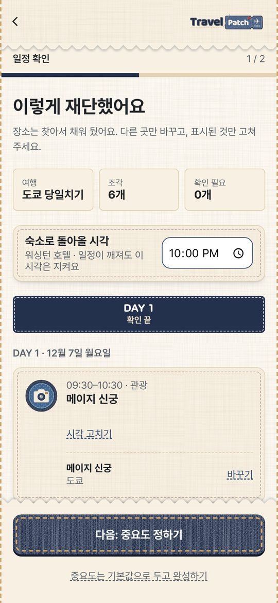
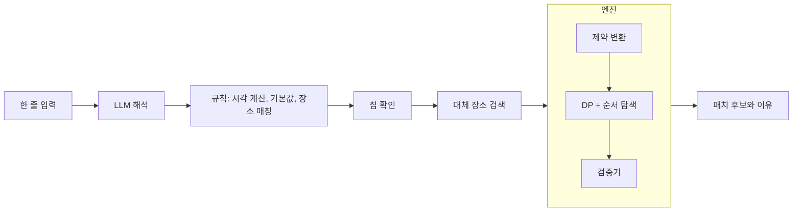

# TravelPatch

여행 중에 일정이 틀어졌을 때, 일정을 새로 짜는 대신 원래 일정에서 꼭 바꿔야 하는 부분만 고쳐 주는 웹서비스.

데모: https://travel-patch.vercel.app

실전웹서비스개발(2026-2) 개인 프로젝트 · 2026.10 – 2026.11 · 기획, 알고리즘, 백엔드, 프론트엔드, 배포 모두 혼자 했다.

## 화면

| 시작 | 일정 붙여넣기 | 재단 확인 | 중요도 3탭 |
|:---:|:---:|:---:|:---:|
|  |  |  |  |
| 새로 짜지 않고 덧대어 고친다 | 메모·카톡 그대로 | 장소 매칭·숙소 복귀 시각 | `꼭` · `좋음` · `선택` |

| 한 줄 → 칩 | 패치 후보 | 대체·대기·이유 | 박음질(확정) |
|:---:|:---:|:---:|:---:|
|  |  |  |  |
| 사건 3개가 칩으로, 고치기·빼기 | 후보 3개, 보존율 한 줄 | 요요기 공원 → 미술관(비), 라멘 +40분 | 원래 계획의 87% 유지 |

<sub>도쿄 당일 일정에 "12시부터 비가 온대. 스카이 예약은 1시간 앞당겨졌고 라멘집은 대기 40분이래"를 입력한 흐름. 로컬에서 Google·OpenAI 응답만 테스트용으로 바꿔 띄운 화면이다.</sub>

## 기획 의도

여행 중에 늦잠을 자거나, 비가 오거나, 가려던 식당이 문을 닫으면 일정이 줄줄이 꼬인다. AI 플래너에게 물어보면 일정을 처음부터 다시 짜 주는데, 예약도 해 두고 동선도 짜 둔 입장에서는 그게 별로 도움이 안 된다. 알고 싶은 건 "원래 계획에서 뭘, 얼마나, 왜 바꿔야 하는지"다.

처음에는 LLM에게 일정을 고쳐 달라고 하면 될 줄 알았다. 실험해 보니 LLM이 낸 답의 83%가 영업시간, 예약 시각, 숙소 복귀 시각 같은 조건을 어겼다. 검증기를 붙여 다시 시키면 위반은 사라졌지만 50개 중 42개는 끝내 통과하는 답을 못 냈다.

그래서 일정 복구를 "원래 일정을 최소한으로 바꾸는 최적화 문제"로 놓고 직접 솔버를 만들었다. LLM은 사용자의 말을 구조화된 값으로 옮기는 데만 쓰고, 무엇을 바꿀지는 솔버가, 결과가 조건을 지키는지는 솔버와 따로 만든 검증기가 판단한다.

## 주요 기능

여행 전에는 메모나 카톡에 적어 둔 일정을 붙여 넣는다. LLM이 시각과 장소로 정리하고 Google Places로 실제 장소를 찾는다. 확인 화면에서 틀린 곳만 고치고, 일정마다 꼭 / 좋음 / 선택 중 하나를 고른다.

여행 중에는 상황을 한 줄로 적는다. 읽은 내용이 칩으로 돌아오고(`12:00부터 비`, `시부야 스카이 예약 17:00 → 16:00`, `이치란 라멘 점심 대기 40분`), 틀린 칩은 고치거나 지울 수 있다. 시간처럼 빠진 값이 있으면 다시 묻는다.

"패치 찾아보기"를 누르면 후보가 2–3개 나온다. 후보마다 원래 계획을 몇 % 지켰는지, 어디를 빼고 줄이고 옮겼는지가 보이고, 바뀐 항목에는 이유(`비 때문에`, `대기 40분 포함`, `예약이 바뀌어서`)가 붙는다. 마음에 안 드는 변경은 "원래대로 두기"로 고정하고 다시 계산할 수 있다. 고른 패치는 저장(박음질)하고, 나중에 되돌릴(실 풀기) 수 있다.

## 시스템 구조



지키려고 한 원칙은 세 가지다.

- 엔진(`backend/app/engine`)은 순수 함수다. LLM, DB, 네트워크, 현재 시각을 쓰지 않는다. 같은 입력이면 항상 같은 결과가 나와서 시나리오 수백 개로 테스트할 수 있다.
- 솔버 결과는 검증기를 통과해야만 사용자에게 간다. 검증기는 솔버 코드를 import하지 않고 일정을 처음부터 다시 시뮬레이션한다. 같은 버그를 공유하면 검증하는 의미가 없어서다.
- 숫자는 LLM이 만들지 않는다. "1시간 앞당겨졌어"에서 LLM은 `-60`만 뽑고, 새 시각 계산이나 "지금부터" 같은 기본값은 규칙이 채운다. 이유 문장 속 숫자와 장소명도 솔버 값에서 가져온다.

### 복구 알고리즘

남은 일정마다 유지, 이동, 단축(5분 단위), 삭제, 대체, 연장 중 하나를 고른다. 영업시간, 예약 시각, 이동시간, 숙소 복귀 시각, `꼭` 일정 삭제 금지는 반드시 지켜야 하는 조건이고, 사건에서 온 조건(비 오는 시간 야외 금지, 피곤하면 걷는 일정 길이 상한 등)이 더해진다.

목적함수는 변경량의 가중합이다.

```
RC = w1·D_drop + w2·D_shrink + w3·D_sub + w4·D_order + w5·D_time + w6·D_move + w7·D_intent (+ w8·D_outdoor)
```

삭제·단축·대체한 일정의 가치, 원래 순서와의 거리(Kendall tau), 시작 시각과 이동시간 변화, 하루에서 사라진 목적(식사, 쇼핑 등)을 더한다. 사용자에게는 RC 대신 `1 − (삭제 + 단축 + 대체 손실) / 전체 가치`인 보존율을 보여 준다.

풀이는 원래 순서로 DP를 돌리고(상태: 처리한 일정 수, 현재 시각, 마지막 장소), 인접 교환과 한 개 옮기기로 순서를 바꿔 가며 다시 돌린다. 이걸 가중치와 조건이 다른 전략(관광 보존, 여유, 예약 보존, 이동 최소화 등)마다 반복해서 서로 다른 후보를 만든다. "이걸 살리면?"은 그 일정을 고정하고 다시 푼 결과라서, 그럴듯한 문장이 아니라 실제로 계산된 차이다.

### 한 줄 입력 처리

한 문장에 여러 일이 섞여 있어도 사건별로 나눈다. 지연, 비, 휴무, 피곤, 연장, 대기, 예약 변경, 꼭 가고 싶은 곳 추가를 받고, 사건 외에 "실내 위주로", "덜 걷고 싶어", "좀 쉬고 싶어" 같은 바람도 따로 받는다. 엔진은 사건 최대 5개의 조건을 한꺼번에 쌓아서 푼다.

LLM이 사용자가 하지 않은 말을 지어내는 경우가 있어서, 바람마다 근거가 된 단어를 같이 받고 그 단어가 원문에 없으면 버린다. 휴무나 비 때문에 대체 장소가 필요하면 근처를 Google에서 찾되, 장소 종류(공원, 미술관 등)로 실내/야외를 판단하고 숙소나 같은 날 이미 가는 곳은 뺀다.

## 성능 평가

### 비교 실험 (50개 시나리오)

일정 10개 × 사건 5종(지연, 비, 휴무, 피곤, 연장).

| 방법 | 제약 위반 | 해 없음 | 보존율 | 평균 시간 |
|---|---|---|---|---|
| 전부 뒤로 밀기 | 62% | 0 | 93.8% | 0.3ms |
| Greedy | 62% | 0 | 75.4% | 0.2ms |
| LLM 단독 | 83% | 21 | 78.2% | 2.7s |
| LLM + 검증기 | 0% | 42 | 82.9% | 4.7s |
| 이 엔진 | 0% | 5 | 90.2% | 148ms |

보존율은 위반이 없는 답만 집계했다. 뒤로 밀기의 보존율이 높은 건 아무것도 안 지운 19개만 남아서다. 엔진이 해를 못 낸 5개는 예약 시각이 이미 지났거나 예약된 야외 일정이 비와 겹치는 등 원래 불가능한 경우고, 이때는 무엇이 막는지 알려 준다. LLM 방법은 `gpt-4o-mini`로 3회 반복했다. 결과: [`eval/results/summary.md`](eval/results/summary.md)

사건 2–3개가 겹친 30개 시나리오(`eval/results/multi30`)에서도 엔진은 위반 0%, 보존율 90.5%였다. 뒤로 밀기는 87%, Greedy는 80%가 위반이었다.

### 한 줄 입력 해석

| | 처음 | 프롬프트·규칙 수정 후 | 해석 모델 변경 후 |
|---|---|---|---|
| 문장 52개 | 43 | 48–49 | 50 |
| 사건이 겹친 문장 12개 | – | 11–12 | 12 |

겹친 문장은 읽기만 맞는지가 아니라, 나온 후보가 모든 사건에 맞게 바뀌었는지까지 본다. 바뀐 예약 시각에 가는지, 대기 시간이 식사 안에 들어갔는지, 닫은 곳에 안 가는지, 비 오는 시간에 야외에 있지 않은지 등이다(`backend/tests/services/multi_eval.py`). 지금 못 맞히는 건 "쇼핑 더 하고 싶어"(연장인데 피곤으로 읽음) 정도다.

## 트러블슈팅

직접 만든 5개 도시 여행으로 써 보고, 실제 모델과 Google을 붙여 테스트하면서 찾은 것들이다.

- 실제로 등록한 여행에서는 비가 와도 일정이 하나도 안 바뀌었다. 테스트 데이터에는 야외/실내 정보가 있었는데 실제 여행은 전부 "모름"이었기 때문이다. Google 장소 종류(park, museum 등)로 채우는 규칙을 넣었다.
- 루브르가 휴관이면 같은 날 이미 가는 카페로 대체되고, 고친 뒤에는 숙소가 대체 장소로 뽑혔다. 그날 다른 일정과 숙소 근처, 숙박 시설, 종류가 다른 곳을 후보에서 뺐다. 지금은 오르세 미술관으로 바뀐다.
- "도쿄타워 꼭 가고 싶어"에 모델이 실내·덜 걷기·쉬기를 붙였다. 칩만 틀리는 게 아니라 걷는 일정이 절반으로 줄어드는 식으로 패치가 바뀐다. 위에 쓴 근거 단어 확인을 넣었다.
- 프롬프트에 예시를 넣어도 `gpt-4o-mini`는 "피곤하고 비도 와서 실내에서 쉬고 싶어"에서 비를 계속 빠뜨렸다. 한 줄 해석만 `gpt-4.1-mini`로 바꿨다. 답이 짧아서 비용 차이는 작다.
- "타워 브리지 공사 + 비"를 넣으면 결과가 아예 안 나왔다. 같은 장소를 휴무와 비 때문에 두 번 검색해서 ID가 겹친 것이었다.
- 테스트 몇 번 만에 Google 일일 한도에 걸렸다. 대체 장소를 찾을 때 후보마다 영업시간을 따로 조회하고 있었다. 검색 요청에서 영업시간까지 같이 받게 바꿔서 요청 수와 비용을 4분의 1 정도로 줄였다.
- 쉬고 싶다는 말이 없는데도 하루를 통째로 20–30분씩 미는 후보가 나왔다. 다른 후보와 내용이 같고 시각만 다르면 숨기게 했다.

## 테스트 및 운영

- 백엔드 테스트 754개, 실제 OpenAI·Google을 부르는 테스트 96개(따로 실행), 프론트 테스트 143개. 엔진을 바꾸면 기준 시나리오 6개와 평가 세트 110개가 모두 통과해야 한다. 기대값은 정답 일정이 아니라 "위반 0", "꼭 일정 유지" 같은 속성으로 둔다.
- LLM과 Google 호출에는 하루 한도가 있다(게스트 IP별, 게스트 전체, 로그인 사용자별). LLM 응답 형식이 틀리면 한 번만 다시 시도하고, 그래도 안 되면 사용자가 직접 고르게 한다. Google이 실패해도 패치는 대체 장소 없이 나온다.
- Google 데이터는 약관상 저장해도 되는 것만 저장한다(장소 ID, 좌표 29일). 영업시간을 모르는 장소는 "현장 확인 필요"로 표시한다.

## 기술 스택

- Backend: FastAPI, Python 3.12, Pydantic v2, uv
- 엔진: 직접 구현한 DP + 순서 국소탐색 (외부 솔버 없음)
- Frontend: React 19, Vite, TypeScript, 모바일 우선
- DB·인증: Supabase (PostgreSQL, Auth, RLS)
- 외부: OpenAI structured output, Google Places
- 배포: Vercel(프론트), Render(백엔드)

```
backend/app/
  engine/     최적화, 검증기, 비용, 반사실 계산 (순수 함수)
  llm/        일정 파싱, 상황 해석, 대체 장소 검색어
  services/   DB, Google, LLM을 엮는 부분
  routers/    API
backend/tests/  단위·시나리오·평가 테스트
frontend/src/   화면, 컴포넌트, API 타입(OpenAPI에서 생성)
eval/           비교 실험 스크립트와 결과
```

## 실행 방법

### 환경 변수

루트에 `.env`:

```
OPENAI_KEY=
OPENAI_MODEL=                 # 선택. 기본 gpt-4o-mini (일정 파싱 등)
OPENAI_INTERPRET_MODEL=       # 선택. 한 줄 입력 해석, 기본 gpt-4.1-mini
GOOGLE_PLACES_API_KEY=
GOOGLE_ROUTES_API_KEY=        # ROUTES_TRAVEL_ENABLED=1 일 때만 사용
SUPABASE_URL=
SUPABASE_ANON_KEY=
SUPABASE_SERVICE_ROLE_KEY=
```

`frontend/.env.local`:

```
VITE_SUPABASE_URL=
VITE_SUPABASE_ANON_KEY=
```

### Backend

```bash
cd backend
uv sync
uv run uvicorn app.main:app --reload
uv run pytest -q          # 외부 API를 부르지 않는 테스트
uv run pytest -m live     # 실제 OpenAI·Google 호출
```

### Frontend

```bash
cd frontend
npm install
npm run dev
npm run gen:api           # 백엔드 OpenAPI에서 API 타입 재생성
npm test
```

### 비교 실험

```bash
# 뒤로 밀기, Greedy, 엔진 (API 키 없이)
python -m eval.run --scenarios backend/tests/scenarios/eval50 --out eval/results

# LLM 방법까지. 응답은 디스크에 캐시돼서 다시 돌려도 같은 결과
python -m eval.run --scenarios backend/tests/scenarios/eval50 --out eval/results --with-llm
```

## 한계 및 향후 계획

- 처음부터 불가능한 일정(예약 뒤 이동시간 없이 다음 예약)을 등록할 때 알려 주지 않는다. 다음에 할 일 1순위.
- 비 오는 날 빠진 일정의 대체 장소를 찾을 때 아직 실내로 좁히지 않아서 검색이 낭비된다.
- 한 여행은 한 도시, 복구는 하루 단위다. 실시간 위치·교통·날씨 API나 실제 예약 변경은 하지 않는다.
